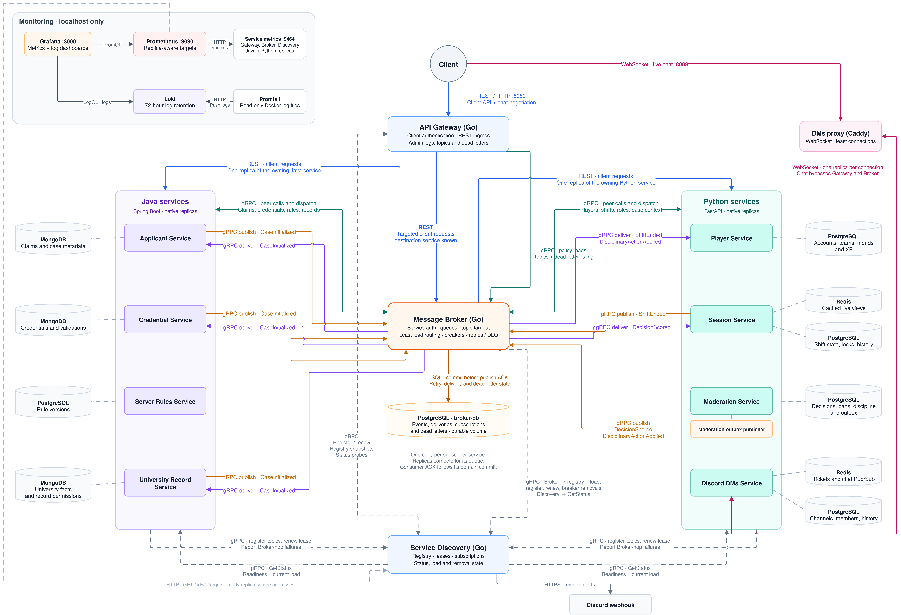

# Student ID, please

Student ID, please is a game about moderating a university Discord server. Junior Moderators inspect assigned university records and share findings in chat. The Moderator compares those findings with an applicant's claims and credentials, then accepts, rejects, flags, or bans the applicant.

The Common Project Repository, or CPR, contains the shared design, integration contracts, deployment, and service release pointers. Service implementations live in private repositories. Their container images are public.

## Architecture

Eight domain services own separate data. Clients reach them with REST through the gateway, and the gateway sends each client request to the Message Broker over REST. Service-to-service calls and topic events are typed gRPC on port `50051`, and they also go through the Broker. Chat uses WebSockets through the Discord DMs proxy.

The diagram below shows the client paths, the gateway, the Message Broker, Service Discovery, the domain services, their storage, and monitoring. Its editable source is [`docs/architecture.drawio`](docs/architecture.drawio). Blue arrows are client REST: the gateway sends each targeted request to the Broker, which forwards it to one replica of the owning service. Green arrows are gRPC peer calls and dispatch. Orange and purple arrows are gRPC topic publish and delivery, with accepted messages stored in `broker-db`. Gray dashed arrows are gRPC Discovery calls: registration, topic subscriptions, lease renewal, status and load probes, and Broker-hop failure reports. Live chat uses a WebSocket through the DMs proxy and bypasses the gateway and the Broker. Prometheus finds replicas through Discovery, and Grafana shows metrics and Loki logs on `localhost` only.



[Architecture](docs/architecture.md) explains ownership and technology choices. The [demonstration guide](docs/demonstration.md) shows how to start, scale, and observe the stack. [Game flows](docs/flows.md) describe a shift. [Integration principles](docs/integration.md) explain mocked and integrated deployments.

## Gateway

The selected gateway is shared Go infrastructure, separate from the eight domain services. All client-to-service REST traffic uses its public listener. The gateway validates client identity, applies the public policy, signs the receiver assertion, bounds task duration and concurrency, and sends each request to the Message Broker with its target service. Its control listener on `:8083` serves only `/healthz`. Status and log export use its gRPC `ControlService` on `:50051`. Domain services retain business authorization and data ownership.

Realtime negotiation uses REST through the gateway, which returns one configured chat URL, the DMs proxy on port `8009`. The proxy is Caddy. It balances WebSocket upgrades across the `discord-dms` replicas by least connections. The gateway and the Broker do not relay frames. Chat tickets, permissions, Redis delivery, and stored history belong to Discord DMs.

Service-owned storage connections do not pass through the gateway or the Broker.

## Monitoring

Prometheus and Grafana start with the stack and publish only to `127.0.0.1`, on ports `9090` and `3000`. Prometheus scrapes the private `/metrics` port of every replica that Discovery lists, so scaled replicas appear without configuration. Grafana provisions the `Student ID services` and `Student ID broker` dashboards. Promtail and Loki collect the service logs from Docker's log files, with 72 hours of retention, and the `Student ID logs` dashboard shows them next to the metrics. Sign in as `admin` with `GRAFANA_ADMIN_PASSWORD` from `.env`. The [demonstration guide](docs/demonstration.md#monitor-the-stack) shows the dashboards, how to query Prometheus, and how to follow one request ID through the logs, and the [metrics contract](docs/contracts/metrics.md) defines the metrics.

## Message Broker

The Message Broker is shared Go infrastructure in the private `ChillGuysStudio/message-broker-service` repository, with the public image `maxnoragami/message-broker-service`. Compose runs one instance as `message-broker`, with REST for Gateway dispatch on port `8080` and gRPC on port `50051` of the container network, and no host port.

The Broker owns service-to-service dispatch, service-call authorization, replica load balancing, backend breakers, and topic event delivery. A targeted request names its destination service. Gateway sends public requests there over REST with an explicit target. Domain services send every peer call there as a typed gRPC call with the `x-broker-target` metadata key. The Broker authenticates the caller, signs the receiver assertion, selects the ready replica with the lowest load, and writes a `dispatch` log record for each attempt. After a failed attempt, it can reroute an eligible request to another replica within the same budget, as the [load routing contract](docs/contracts/routing.md) defines. It reports breaker trips to Discovery.

Producers publish domain events to the Broker by topic. The Broker stores each event and one delivery per subscribing service in its own PostgreSQL, `broker-db`, and retries each delivery a bounded number of times. A delivery that the subscriber rejects, or that fails every attempt, moves to a dead-letter table that administrators can list. The [queues and topics contract](docs/contracts/queues.md) defines targeted queues and topic delivery, and the [dead-letter contract](docs/contracts/dead-letters.md) defines the retry limit and the dead-letter listing. The [service-to-service gRPC contract](docs/contracts/grpc.md) defines the RPCs, metadata, and status mapping. Client authentication, Discord DMs WebSockets, event schemas, and domain ownership stay unchanged. The [Message Broker dispatch contract](docs/contracts/broker.md) defines the credentials, assertions, attribution, and logging.

[`docs/releases/services.json`](docs/releases/services.json) records the released version, source commit, and image digest of each service. [Gateway authorization](docs/architecture.md#gateway-authorization) describes identity checks and service permissions; the [guided Postman demo](postman/GUIDED-DEMO.md) covers real Gateway HTTP flows and bounded concurrent tasks.

## Team and services

| Developer | Owned services | Stack | Source profile |
| --- | --- | --- | --- |
| Chicu Andrei | Moderation, Discord DMs | Python, FastAPI | `andrei` |
| Vremere Adrian | Applicant, Credential | Java, Spring Boot | `adrian` |
| Alexei Maxim | Server Rules, University Record | Java, Spring Boot | `alexei` |
| Cebotari Alexandru | Player, Session | Python, FastAPI | `alexandru` |

[Service references](docs/services/README.md) list public images and integration settings. The [submodule configuration](.gitmodules) lists private source repositories. The gateway is shared infrastructure, separate from each developer's two domain services.

## Run the stack

The stack runs with plain Docker Compose commands. Each domain service starts two replicas. Every replica generates its own instance ID and registers its own container address with Discovery, so scaling needs no per-replica configuration:

```sh
python3 scripts/setup.py
docker compose up -d --wait
python3 scripts/seed_university_catalog.py
python3 scripts/warehouse_roles.py
docker compose up -d --no-deps --scale applicant=4 applicant
docker compose ps applicant
docker compose logs -f --tail 50 --timestamps message-broker discovery applicant
docker stop <container-id>
docker compose up -d --no-deps --scale applicant=2 applicant
```

`scripts/warehouse_roles.py` creates the read-only `warehouse_reader` role on every datastore. Until it runs, each ETL load reports every source as `failed` with `unauthorized`. Running it again is safe.

A stopped replica deregisters itself before it exits. Discord DMs scales the same way, for example with `--scale discord-dms=3`. Clients open chat on the `dms-proxy` port `8009`, which balances the replicas, so no replica has a host port. The [demonstration guide](docs/demonstration.md) explains each command.

### Load the warehouse

The `etl` service copies analytics data from the eight domain datastores into `warehouse-db` every `ETL_INTERVAL`, five minutes by default. It has no HTTP endpoint. Run one load and read the latest run records:

```sh
docker compose run --rm etl --once
docker compose exec warehouse-db psql -U warehouse -c "SELECT source, outcome, rows_read, rows_written, error_kind, finished_at FROM warehouse.etl_runs ORDER BY finished_at DESC LIMIT 8"
```

The load exits with status 0 when every source is `ok` or `partial`, 3 when another run holds the lock, and 1 otherwise. A second load writes no rows. The [warehouse contract](docs/contracts/warehouse.md) defines the tables, and [Load the warehouse](docs/demonstration.md#load-the-warehouse) shows a failed source.

### Check database failover

Player, Session, Moderation, Discord DMs, and Server Rules each run three PostgreSQL nodes under Patroni, with one shared etcd. Applicant and Credential share a MongoDB replica set of three members, and University Record has its own. List the Player nodes, then run the failover check for every database or for the ones you name:

```sh
docker compose exec player-db-1 patronictl -c /config/patroni.yml list
python3 scripts/check_failover.py
python3 scripts/check_failover.py player-db
```

The check kills each primary, waits until another member accepts writes, starts the killed member, and checks that it has both markers. It takes about four minutes for all seven databases. Run nothing else that stops containers at the same time. The names are `player-db`, `session-db`, `moderation-db`, `dms-db`, `rules-db`, `mongodb`, and `university-mongodb`. The [replication contract](docs/contracts/replication.md) defines the topology, and [Fail over a database](docs/demonstration.md#fail-over-a-database) kills one primary by hand.

### Inspect the cache ring

Services cache common reads and authentication data on three Redis nodes, `cache-1` to `cache-3`. A consistent-hash ring assigns each key to one node, so losing a node moves only that node's keys. Count the keys on each node:

```sh
for n in 1 2 3; do echo "cache-$n $(docker compose exec -T cache-$n redis-cli dbsize)"; done
```

The cache changes no endpoint. A request returns the same status and body with or without it. The [cache contract](docs/contracts/cache.md) lists the cached reads, the [sharding contract](docs/contracts/cache-sharding.md) defines the ring, and [Shard the cache](docs/demonstration.md#shard-the-cache) stops one node.

### Check the end-shift saga

Ending a shift runs as a saga that the Message Broker coordinates. Session holds the shift in `ending`, Player awards the XP, and Session ends the shift. When the award fails for good, compensations reverse the award and reopen the shift. Run every case of the saga check, or name one:

```sh
python3 scripts/check_sagas.py
python3 scripts/check_sagas.py normal
```

The cases are `normal`, `player-outage`, `compensation`, `broker-restart`, and `repeated-step`. The check stops and starts Player and the Broker, so run nothing else that does at the same time.

To list sagas, grant a player administrator access, then log in as that player with `POST /api/v1/auth/login` and put its `access_token` in `ADMIN_TOKEN`. Revoke the access afterwards:

```sh
docker compose exec player python -m app.admin <player-id> --grant
curl -fsS -H "Authorization: Bearer $ADMIN_TOKEN" 'http://127.0.0.1:8080/api/v1/admin/broker/sagas?limit=20&flow=end-shift'
docker compose exec player python -m app.admin <player-id> --revoke
```

The [distributed transactions contract](docs/contracts/transactions.md) defines the steps, retries, and compensations.

## New and changed endpoints

Since the v4 releases, the public API adds one endpoint and changes one. The warehouse, the replicated databases, and the cache add no endpoint. The [service APIs](docs/contracts/api.md) have the full tables, and [End a shift](docs/contracts/api.md#end-a-shift) explains each response of the end route. Errors use the shared `Error = {code, message, request_id, details: {field, reason}[]}` shape of the [HTTP conventions](docs/contracts/http.md).

| Method and route | Authorization | Request | Responses | Errors |
| --- | --- | --- | --- | --- |
| `GET /api/v1/admin/broker/sagas` (new) | Global administrator | Optional query `limit` (1 to 100, default 20), `cursor`, `flow`, and `state` | `200 SagaPage`, newest first | `400 VALIDATION_ERROR`, `401 UNAUTHORIZED`, `403 FORBIDDEN`, `503 DEPENDENCY_UNAVAILABLE` |
| `POST /api/v1/sessions/{session_id}/end` (changed) | Session owner | `Idempotency-Key: <UUID>` and an empty object | `200 Session` in `ended`<br>`202 Session` in `ending` while the saga runs | `409 PROGRESSION_REJECTED` when the saga compensates, with the cause in `details`. The shift is `active` again. Existing errors: `400 IDEMPOTENCY_KEY_REQUIRED`, `401 UNAUTHORIZED`, `403 SESSION_FORBIDDEN`, `404 SESSION_NOT_FOUND`, `409 INVALID_SESSION_STATE`, `409 CASE_UNFINISHED`, `422 INVALID_INPUT`, `503 STORAGE_UNAVAILABLE`, and `504 TASK_TIMEOUT` |

```text
SagaPage = {items: SagaSummary[], next_cursor: string | null}
SagaSummary = {saga_id: Id, flow: string, initiator: string,
               state: "running" | "compensating" | "completed" | "compensated",
               cause: SagaCause | null, created_at: Time, deadline: Time, updated_at: Time,
               finished_at: Time | null, steps: SagaStep[]}
SagaCause = {operation: string, kind: "rejected" | "attempts" | "deadline", code: string | null}
SagaStep = {position: Int, service: string, operation: string,
            state: "pending" | "done" | "failed" | "compensated" | "skipped",
            attempts: Int, compensation_attempts: Int, last_status: Int | null, last_error_kind: string}
Participant = {player_id: Id, role: Role}
Session = {session_id: Id, team_id: Id, owner_id: Id,
           status: "lobby" | "active" | "ending" | "ended",
           participants: Participant[], rule_version: Id | null, started_at: Time | null,
           university_snapshot_id: Id | null,
           current_case_id: Id | null, processed_count: Int, score: Int, penalties: Int}
```

Other changes that clients see:

- `GET /api/v1/sessions/{session_id}` and `GET /api/v1/sessions` show a shift as `ending` while its saga runs. An `ending` shift accepts no case start, decision, or other change.
- A compensated saga reverses the XP award with a `shift_reversal` ledger entry, so `xp` and `level` in `Player` can go down again.
- Every endpoint whose service cannot reach a writable datastore during a failover returns `503 STORAGE_UNAVAILABLE`. Retry a write with the same `Idempotency-Key`.

## Start work

Read [CONTRIBUTING.md](CONTRIBUTING.md) for CPR rules. Follow [the development guide](docs/development.md) to run public images, install hooks, or check out only your two services. The default setup does not fetch private source.

## Policy changes

Rules introduced by updates to this README or the other project documentation apply after those updates are merged. Earlier commits, branches, pull requests, merges, tags, releases, and other repository actions are judged by the rules in effect when they occurred. Actions that followed the previous README and documentation are not violations of rules introduced later. Work on an open pull request is assessed when that pull request merges. Convention breaks before merge, and anything on a pull request closed without merging, are not violations.

## Documentation

- [Demonstration guide](docs/demonstration.md)
- [HTTP conventions](docs/contracts/http.md)
- [Discovery and resilience contract](docs/contracts/resilience.md)
- [Message Broker dispatch contract](docs/contracts/broker.md)
- [Domain types](docs/contracts/domain.md)
- [Service APIs](docs/contracts/api.md)
- [Case initialization](docs/contracts/cases.md)
- [Simulation data](docs/contracts/simulation.md)
- [Domain events](docs/contracts/events.md)
- [Message Broker queues and topics](docs/contracts/queues.md)
- [Durable delivery and dead letters](docs/contracts/dead-letters.md)
- [Warehouse and ETL](docs/contracts/warehouse.md)
- [Database replication](docs/contracts/replication.md)
- [Cache](docs/contracts/cache.md)
- [Cache sharding](docs/contracts/cache-sharding.md)
- [Distributed transactions](docs/contracts/transactions.md)
- [Service-to-service gRPC](docs/contracts/grpc.md)
- [Load routing and rerouting](docs/contracts/routing.md)
- [Service metrics and monitoring](docs/contracts/metrics.md)
- [Release procedure](docs/releases.md)
- [GitHub checks and permissions](docs/github.md)

The [project board](https://github.com/orgs/ChillGuysStudio/projects/2) tracks team tasks.
