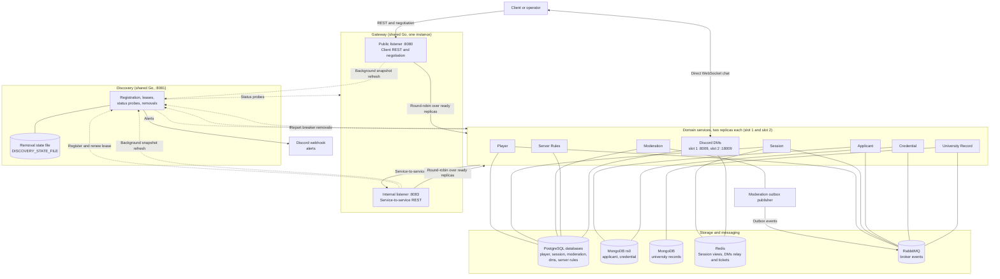

# Student ID, please

Student ID, please is a game about moderating a university Discord server. Junior Moderators inspect assigned university records and share findings in chat. The Moderator compares those findings with an applicant's claims and credentials, then accepts, rejects, flags, or bans the applicant.

The Common Project Repository, or CPR, contains the shared design, integration contracts, deployment, and service release pointers. Service implementations live in private repositories. Their container images are public.

## Architecture

Eight domain services own separate data. They communicate through REST, RabbitMQ events, and WebSocket chat. The gateway section below describes the topology.

The diagram below shows the gateway, Discovery, the two replicas of each domain service, and their storage. Its source is [`docs/diagrams/architecture.mmd`](docs/diagrams/architecture.mmd), and a test keeps this copy identical to it. Client and service REST pass through the gateway. Live chat uses a direct client-to-Discord DMs WebSocket. Replicas register with Discovery, and Discovery probes them.

[Architecture](docs/architecture.md) explains ownership and technology choices. The [demonstration guide](docs/demonstration.md) shows how to start the stack and run the verification suite. [Game flows](docs/flows.md) describe a shift. [Integration principles](docs/integration.md) explain mocked and integrated deployments.

## Gateway

The selected gateway is shared Go infrastructure, separate from the eight domain services. All client-to-service REST traffic uses its public listener. All service-to-service REST traffic uses its internal listener, which is not publicly exposed. The gateway validates client identity, routes requests, and bounds task duration and concurrency. Domain services retain business authorization and data ownership.

Realtime negotiation uses REST through the gateway and returns a direct Discord DMs WebSocket URL. Clients connect to Discord DMs for the upgrade and chat frames. The gateway does not relay frames. Chat tickets, permissions, Redis delivery, and stored history belong to Discord DMs.

RabbitMQ events and service-owned storage connections are not REST routing paths and do not pass through the gateway.

[`docs/releases/services.json`](docs/releases/services.json) records the released version, source commit, and image digest of each service. [Gateway authorization](docs/architecture.md#gateway-authorization) describes identity checks and service permissions; the [guided Postman demo](postman/GUIDED-DEMO.md) covers real Gateway HTTP flows and bounded concurrent tasks.

## Team and services

| Developer | Owned services | Stack | Source profile |
| --- | --- | --- | --- |
| Chicu Andrei | Moderation, Discord DMs | Python, FastAPI | `andrei` |
| Vremere Adrian | Applicant, Credential | Java, Spring Boot | `adrian` |
| Alexei Maxim | Server Rules, University Record | Java, Spring Boot | `alexei` |
| Cebotari Alexandru | Player, Session | Python, FastAPI | `alexandru` |

[Service references](docs/services/README.md) list public images and integration settings. The [submodule configuration](.gitmodules) lists private source repositories. The gateway is shared infrastructure, separate from each developer's two domain services.

## Start work

Read [CONTRIBUTING.md](CONTRIBUTING.md) for CPR rules. Follow [the development guide](docs/development.md) to run public images, install hooks, or check out only your two services. The default setup does not fetch private source.

## Policy changes

Rules introduced by updates to this README or the other project documentation apply after those updates are merged. Earlier commits, branches, pull requests, merges, tags, releases, and other repository actions are judged by the rules in effect when they occurred. Actions that followed the previous README and documentation are not violations of rules introduced later. Work on an open pull request is assessed when that pull request merges. Convention breaks before merge, and anything on a pull request closed without merging, are not violations.

## Documentation

- [Demonstration guide](docs/demonstration.md)
- [HTTP conventions](docs/contracts/http.md)
- [Discovery and resilience contract](docs/contracts/resilience.md)
- [Domain types](docs/contracts/domain.md)
- [Service APIs](docs/contracts/api.md)
- [Case initialization](docs/contracts/cases.md)
- [Simulation data](docs/contracts/simulation.md)
- [RabbitMQ events](docs/contracts/events.md)
- [Release procedure](docs/releases.md)
- [GitHub checks and permissions](docs/github.md)

The [project board](https://github.com/orgs/ChillGuysStudio/projects/2) tracks team tasks.
