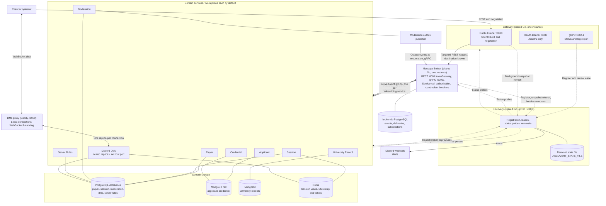

# Architecture

The game separates player progression, shift coordination, evidence, admission policy, and chat. Each service owns its storage. Other services use its APIs or events instead of reading its database.

The diagram below shows the services, replicas, request paths, storage, and event connections. The Message Broker carries both targeted requests and topic events, and keeps topic state in `broker-db`. Its source is [`docs/diagrams/architecture.mmd`](diagrams/architecture.mmd), and a test keeps this copy identical to it. [Game flows](flows.md) describe the request and event sequences. [Integration principles](integration.md) explain how mocks and real peers use these contracts.

## Request paths

The client sends REST to the API gateway. The gateway authenticates it and sends it to the Message Broker over REST with its target service, and the Broker delivers it to one replica. Client requests stay REST end to end. Ticket negotiation uses the same REST path and returns the chat URL of the DMs proxy on port `8009`. The client opens the WebSocket there, and the proxy, a Caddy container, forwards it to the Discord DMs replica with the fewest connections. Neither the gateway nor the Broker relays chat frames.

Service-to-service traffic is typed gRPC on port `50051`, and every peer call passes through the Broker. The [gRPC contract](contracts/grpc.md) defines the peer RPCs, topic publish and delivery, Discovery control, status probes, and log export. Domain events are Broker topics. A producer publishes to the Broker with `PublishEvent`, and the Broker delivers one copy to each subscribing service with `DeliverEvent`. Each service connects only to its own storage, and only the Broker connects to `broker-db`.

The [discovery and resilience contract](contracts/resilience.md) defines registration, routing, health, and failure accounting. The [demonstration guide](demonstration.md) shows how to scale replicas and watch Discovery and the Broker with Compose commands. Private registration, registry lookup, removal, and status probes use direct control-plane gRPC to `DISCOVERY_GRPC_URL` and to each instance's `grpc_url`, which avoids a bootstrap cycle. Discovery supplies replica addresses, and the Broker selects them with round-robin routing. The dashed Discovery links in the diagram show this control plane.

## Service ownership

| Service           | Owns                                                                                                      | Does not own                                                           |
| ----------------- | --------------------------------------------------------------------------------------------------------- | ---------------------------------------------------------------------- |
| Player            | Accounts, authentication, profiles, friendships, teams, XP, and levels                                    | Shift roles, applicants, admission decisions, or shift scores          |
| Session           | Shift lifecycle, roster, roles, pinned configuration, current case, processed count, score, and penalties | Player identity, evidence, policy definitions, or individual decisions |
| Applicant         | Presented claims, profile presets, and its case initialization metadata                                   | Credentials, university truth, or admission policy                     |
| Credential        | Document templates, presented documents, and validation results                                           | Applicant claims, university truth, or access policy                   |
| Server Rules      | Draft and published rulesets, policy evaluation                                                           | Evidence, stored bans, player actions, or scoring                      |
| University Record | Reference facts, identity reservations, shift snapshots, case records, and record permissions             | Claims, document authenticity, or admission decisions                  |
| Moderation        | Final decisions, policy snapshots, subject bans, decision scores, and administrator disciplinary actions  | Source evidence, rule definitions, aggregate shift scores, or XP       |
| Discord DMs       | Channels, membership, messages, chat tickets, and live delivery                                           | Accounts, shift roles, record permissions, or the truth of a message   |

The gateway is shared Go infrastructure and owns no domain data. Its public listener accepts all client-to-service REST, including realtime negotiation. Its control listener on `:8083` serves only `/healthz` and is not publicly exposed. Status and log export use its gRPC `ControlService`. The Message Broker carries all service-to-service gRPC. Services retain business authorization after the gateway or the Broker verifies identity. Internal endpoints are not public routes.

REST negotiation returns one configured chat URL, `GATEWAY_CHAT_WS_URL`, which points at the DMs proxy. The client sends the upgrade and later chat frames there, and the proxy keeps each connection on one Discord DMs replica. Chat must bypass the gateway and the Broker, so the proxy balances chat connections while the Broker balances service-to-service calls. Redis carries tickets and fan-out between DMs replicas. The gateway does not relay frames or hold the live data connection. Discord DMs owns ticket consumption, permission checks, message persistence, and live delivery.

## Message Broker

The Message Broker is shared Go infrastructure with the public image `maxnoragami/message-broker-service`. Compose runs one instance as `message-broker`. It listens on `:8080` for Gateway's REST dispatch and on `:50051` for gRPC, on the container network with no host port. It registers with Discovery as `message-broker`. Discovery rejects two live instances with one address, so the Broker does not scale.

The Broker owns service-to-service dispatch, service-call authorization, replica selection, and backend breakers. The [Message Broker dispatch contract](contracts/broker.md) defines both of its request modes:

- Gateway dispatch. Gateway authenticates the client, applies the public policy, signs the receiver assertion with `gateway-v1`, and sends the request with `X-Broker-Target`. The Broker verifies that assertion and forwards it to one ready replica of the target.
- Service ingress. A domain service sends a peer RPC with its caller name and token in metadata. The Broker matches the RPC policy table, applies the caller allowlist and the delegated or workload policy, signs the receiver assertion with `broker-v1`, and dispatches.

Receivers accept a request only from `message-broker` with their own hop token. They verify Gateway-issued assertions with the Gateway key and Broker-issued assertions with the Broker key. The Broker selects replicas with one round-robin cursor per service, trips a generation's breaker after three qualifying failures within `W`, and reports the trip to Discovery. It writes one `dispatch` log record for each attempt.

These boundaries apply:

- Only the gateway's public listener accepts client traffic.
- The gateway keeps client authentication and its ingress task and concurrency limits. The Broker authenticates the calling service and carries the verified caller and player context to the receiver. Receivers keep their business authorization.
- The gateway assigns a UUID `X-Request-ID` to every request, forwards it, and returns it in the response and in the error `request_id`. The Broker keeps that ID on each hop. Events keep their `event_id` and `correlation_id`.
- Each hop uses one deadline. It is the outbound timeout `T`, 2 seconds by default, capped by the caller's remaining task budget. The gateway task budget stays 30 seconds. No layer replays a business write after a timeout. The [discovery and resilience contract](contracts/resilience.md) defines `T` and the breaker window.

Discord DMs WebSockets stay outside the Broker. Public routes and their responses do not change.

The Broker also carries the [domain events](contracts/events.md) as topics. A topic event names a topic, not its recipients, and every subscribing service receives one copy. The topics are the four existing events, `CaseInitialized`, `DecisionScored`, `ShiftEnded`, and `DisciplinaryActionApplied`. Each replica declares the topics it consumes when it registers with Discovery, and the Broker derives `subscriptions` from those registrations. Events, deliveries, and subscriptions live in the Broker's own PostgreSQL, `broker-db`. The [queues and topics contract](contracts/queues.md) defines the targeted queues, topic delivery, subscriptions, and retries.

## Gateway authorization

The gateway validates client bearer tokens and removes the original `Authorization` header before forwarding a request. A receiving service uses verified identity to check access to its own resources. Player owns accounts and token issuance; the gateway verifies those tokens at the request boundary.

Internal requests authenticate the calling service and retain the initiating player's identity when the operation requires it. Services check participation, roles, and resource permissions. Gateway routing does not grant access to another player's records or administrator operations.

## Storage

| Service           | Durable storage                                                       | Redis use                               |
| ----------------- | --------------------------------------------------------------------- | --------------------------------------- |
| Player            | PostgreSQL                                                            | None                                    |
| Session           | PostgreSQL for state, locks, history, and event records               | Cached live views                       |
| Applicant         | MongoDB for presets and case claims                                   | None                                    |
| Credential        | MongoDB for templates, documents, and validations                     | None                                    |
| Server Rules      | PostgreSQL for drafts and immutable published versions                | None                                    |
| University Record | MongoDB for reference data, reservations, snapshots, and case records | None                                    |
| Moderation        | PostgreSQL for decisions, bans, discipline, and outbox rows           | None                                    |
| Discord DMs       | PostgreSQL for channels, membership, and history                      | Single-use tickets and Pub/Sub delivery |

A dedicated database belongs to each service. Sharing a database server in the development deployment does not allow services to use each other's collections or tables. Database foreign keys never cross service boundaries.

MongoDB case operations use local transactions and require a replica set. PostgreSQL transactions protect domain changes and event records. Session uses PostgreSQL transaction advisory locks to serialize mutations for one shift. Redis caches rebuildable Session views and is not the source of shift state, scores, locks, or chat history.

## Communication

| Caller or producer                    | Receiver or consumer                     | Purpose                                                                            |
| ------------------------------------- | ---------------------------------------- | ---------------------------------------------------------------------------------- |
| Client through public gateway         | Public services                          | Public REST commands and permitted reads, including Player authentication          |
| Client through public gateway         | Discord DMs                              | REST realtime negotiation, chat tickets, channels, and history                     |
| Client through the DMs proxy          | Discord DMs                              | WebSocket upgrade and live chat frames after negotiation                           |
| Session through the Broker            | Player                                   | Check players and team membership over gRPC                                        |
| Session through the Broker            | Server Rules, University Record          | Pin policy, validate permission distribution, and create a reference snapshot over gRPC |
| Session through the Broker            | Applicant, Credential, University Record | Select one initializer and poll all three owners for readiness over gRPC            |
| Moderation through the Broker         | Session                                  | Check the active shift, assigned Moderator, current case, aggregate readiness, and pinned configuration over gRPC |
| Moderation through the Broker         | Applicant, Credential, University Record | Read complete case evidence over gRPC                                               |
| Moderation through the Broker         | Server Rules                             | Evaluate evidence, existing subject bans, and prior history over gRPC                |
| Moderation through the Broker         | Player                                   | Check a disciplinary action's target over gRPC                                      |
| Evidence services, Rules, Discord DMs through the Broker       | Session                  | Check participation, roles, and lifecycle over gRPC                                  |
| Discord DMs through the Broker        | University Record                        | Check record-derived channel access over gRPC                                       |
| Applicant, Credential through the Broker       | University Record                  | Read a snapshot and reserve or read an identity over gRPC                            |
| One case initializer                  | Other case owners                        | Derive owned records from `CaseInitialized`                                        |
| Moderation                            | Session                                  | Apply `DecisionScored` once                                                        |
| Session                               | Player                                   | Apply `ShiftEnded` once                                                            |
| Moderation                            | Player                                   | Apply `DisciplinaryActionApplied` once                                             |

[HTTP conventions](contracts/http.md), [service APIs](contracts/api.md), and [domain events](contracts/events.md) define the request and payload details. The [logging contract](contracts/logging.md) defines log records, retention, instance exports, and the administrator log download.

All client-to-service REST uses the public gateway. All service-to-service traffic is typed gRPC through the [Message Broker](#message-broker), and the [gRPC contract](contracts/grpc.md) names each RPC. The final four rows describe topic events, which producers publish to the Broker and the Broker delivers to each subscribing service. Service-owned storage connections and WebSocket upgrades and frames do not pass through the gateway or the Broker. The DMs proxy balances chat connections.

## Data and consistency

A `player_id` identifies a player account. A `subject_id` identifies a simulated person. A `case_id` identifies one application. Bans use `subject_id`, so returning under another case does not remove a ban.

Each service is the sole writer of its data. An event consumer's local copy does not become a new source of truth. Callers recheck authorization-sensitive data with its owner.

The event flow uses an outbox and consumer deduplication. A producer commits a domain change and its outbox record in one local transaction. It retains the record until the Broker confirms publication. A consumer commits its domain update and deduplication record before acknowledging delivery. Business-ID constraints also prevent duplicate cases, decisions, or progression awards.

The design does not use distributed transactions or claim exactly-once delivery. A partly initialized case stays pending. Missing evidence or an unavailable dependency never becomes a negative admission decision.

Reusable reference data and presets can change through administrative CRUD. Shift snapshots, case evidence, and published policy versions remain immutable. Edits affect future shifts or cases, not evidence already used for scoring.

## Technology choices

Player, Session, Moderation, and Discord DMs use Python and FastAPI. Their work is mostly HTTP, storage, or live delivery. Blocking clients must not run on the WebSocket event loop.

Applicant, Credential, Server Rules, and University Record use Java and Spring Boot. Typed models and validation fit their evidence and policy operations.

The shared gateway uses Go for HTTP listeners, identity verification, and task admission. It owns no domain database. Discovery and the Message Broker also use Go, the team's banned language.

PostgreSQL fits relational state and transaction constraints. MongoDB fits the varied evidence and reference record types. Both stores still enforce the shared contract.

REST serves client reads and commands, and typed gRPC serves the same immediate calls between services. Broker topics carry asynchronous results that consumers can process later, and the Broker retries each delivery until the consumer accepts or rejects it. Discord DMs uses WebSockets for live messages, then REST history to recover missed delivery. Redis Pub/Sub does not retain messages.
