# Lab 3 architecture and demonstration guide

This guide covers the Lab 3 multi-replica architecture, safe demonstration steps for a prepared operator laptop, the requirements checklist for grades 3 through 10, and verified runtime facts.

The historic Lab 2 topology diagram in [architecture.png](architecture.png) and its editable source in [architecture.drawio](architecture.drawio) remain unchanged as the baseline reference.

## Lab 3 architecture

The Lab 3 deployment scales each of the eight domain services to two replicas and adds the Discovery service for instance registration, health monitoring, and circuit breaker removals. Gateway and Discovery use Go, the accepted shared banned language. Domain services continue to use Java with Spring Boot or Python with FastAPI according to the team ownership mapping:

- Adrian (`mcittkmims`): Applicant and Credential (Java, Spring Boot)
- Alexei (`MaxNoragami`): Server Rules and University Record (Java, Spring Boot)
- Andrei (`andyp1xe1`): Moderation and Discord DMs (Python, FastAPI)
- Alexandru (`Tirppy`): Player and Session (Python, FastAPI)
- Shared infrastructure: Gateway and Discovery (Go)

The diagram below shows the Lab 3 topology. Its standalone Mermaid source is in [diagrams/lab3.mmd](diagrams/lab3.mmd).

```mermaid
flowchart TB
	subgraph Clients["Clients"]
		Client["Client or Operator"]
	end

	subgraph GatewaySvc["Gateway Service (Shared Go)"]
		GWPub["Public Listener (:8080)\nClient REST and Negotiation"]
		GWInt["Internal Listener (:8083)\nService-to-Service REST Proxy"]
	end

	subgraph DiscoverySvc["Discovery Service (Shared Go, :8081, discovery-slot-1)"]
		DiscoveryNode["Discovery Engine\nRegistration, Probes, Leases"]
		DiscStorage[("Durable Removal Volume\n(Configured DISCOVERY_STATE_FILE)")]
		DiscoveryNode --- DiscStorage
	end

	subgraph DiscordDMsDomain["Discord DMs Domain Replicas"]
		DMS1["Discord DMs Slot 1 (:8009)"]
		DMS2["Discord DMs Slot 2 (:18009)"]
		RedisRelay[("Redis Store\nPub/Sub and Tickets")]
		DMS1 <--> RedisRelay
		DMS2 <--> RedisRelay
	end

	subgraph DomainReplicas["Domain Service Replicas (2 per Domain)"]
		PlayerReplicas["Player Replicas (Slot 1 and Slot 2)"]
		SessionReplicas["Session Replicas (Slot 1 and Slot 2)"]
		ApplicantReplicas["Applicant Replicas (Slot 1 and Slot 2)"]
		CredentialReplicas["Credential Replicas (Slot 1 and Slot 2)"]
		RulesReplicas["Server Rules Replicas (Slot 1 and Slot 2)"]
		UnivReplicas["University Record Replicas (Slot 1 and Slot 2)"]
		ModReplicas["Moderation Replicas (Slot 1 and Slot 2)"]
	end

	subgraph ModerationWorkers["Moderation Outbox Worker"]
		ModPublisher["Moderation Outbox Publisher\n(Drains outbox table)"]
	end

	subgraph DomainStores["Domain-Owned Storage (9 Backing Stores)"]
		PGStores[("PostgreSQL (5 Stores)\nPlayer, Session, Rules, Mod, DMs")]
		MongoStores[("MongoDB Replica Set (2 Stores)\nApplicant, Credential, Univ")]
		RabbitMQBroker[("RabbitMQ Broker\nVerified: CaseInitialized, DecisionScored, ShiftEnded\nUnverified contract: DisciplinaryActionApplied")]
	end

	subgraph ExternalServices["External Destinations"]
		DiscordHook["Discord Webhook\nReceipt IDs logged; no credentials"]
	end

	Client -->|"Public REST and Negotiation (:8080)"| GWPub
	Client -->|"Direct WS Chat Frames (:8009)"| DMS1
	Client -->|"Direct WS Chat Frames (:18009)"| DMS2

	GWPub -->|"Round-Robin Business REST"| DomainReplicas
	GWPub -->|"Round-Robin Realtime Negotiation"| DiscordDMsDomain

	DomainReplicas -->|"Internal Service REST (:8083)"| GWInt
	DiscordDMsDomain -->|"Internal Service REST (:8083)"| GWInt
	GWInt -->|"Proxied Internal Dispatch"| DomainReplicas

	GWPub -.->|"Background Snapshot Refresh (:8081)"| DiscoveryNode
	GWInt -.->|"Background Snapshot Refresh (:8081)"| DiscoveryNode

	DomainReplicas -.->|"Direct Registration PUT (:8081)"| DiscoveryNode
	DiscordDMsDomain -.->|"Direct Registration PUT (:8081)"| DiscoveryNode
	DiscoveryNode -.->|"Direct Private Status Probes"| DomainReplicas
	DiscoveryNode -.->|"Direct Private Status Probes"| DiscordDMsDomain
	DiscoveryNode -.->|"Direct Private Status Probes"| GatewaySvc

	ModReplicas --- PGStores
	ModPublisher --- PGStores
	ModPublisher -->|"Publishes Outbox Events"| RabbitMQBroker

	DiscoveryNode -->|"Outbound Alerts"| DiscordHook

	DomainReplicas --- PGStores
	DomainReplicas --- MongoStores
	DomainReplicas --- RabbitMQBroker
	DiscordDMsDomain --- PGStores
	SessionReplicas -.->|"Cached Views"| RedisRelay
```



### Request paths and network boundaries

1. Public client REST connects to the Gateway public listener on `127.0.0.1:8080`. Gateway validates client bearer tokens, checks route policy, and selects an active backend replica.
2. Internal service REST connects to the Gateway internal listener on `http://gateway:8083`. This listener is on the private container network and exposes no public host port.
3. Gateway reads the private Discovery service at `http://discovery-slot-1:8081` on this prepared laptop deployment. The shared contract in [docs/contracts/lab3.md](contracts/lab3.md) defines a default port of `:8084`, but deployment configurations can specify a different private port and container name. Gateway refreshes registry snapshots in the background and balances requests across live replicas using lexical round-robin selection.
4. Every replica registers directly with Discovery through private HTTP PUT requests. Every replica also exposes a private health probe endpoint at `GET /internal/v1/status`. Control-plane requests use separate control credentials (`X-Control-Name` and `X-Control-Token`) authenticated against `CONTROL_PLANE_TOKENS`. These credentials stay completely separate from business credentials and Gateway receiver tokens.
5. The stack runs two replicas for each of the eight domain services. Each domain service is the sole owner of its datastore. Replicas of the same service share that service's store; no cross-domain store sharing is permitted. Five dedicated PostgreSQL instances store relational state for Player, Session, Server Rules, Moderation, and Discord DMs. Two MongoDB instances store documents for Applicant, Credential, and University Record.
6. The RabbitMQ broker handles asynchronous domain events. A dedicated publisher process (`moderation-publisher`) drains outbox records from Moderation's PostgreSQL store and publishes them to RabbitMQ. Three domain event paths are implemented and verified historically: `CaseInitialized` by one initializer, `DecisionScored` applied once to Session, and `ShiftEnded` applied once to Player. A fourth event, `DisciplinaryActionApplied`, is defined by contract but remains unverified in runtime evidence.
7. Clients establish direct WebSocket connections to the selected Discord DMs replica on port 8009 or port 18009. The client obtains the replica connection URL through Gateway REST negotiation (`POST /api/v1/sessions/{session_id}/realtime-negotiation`). Gateway does not relay WebSocket upgrade handshakes or chat frames. Redis relays live messages between Discord DMs replicas through Pub/Sub and stores single-use chat tickets.
8. Discovery sends health and critical-load alerts to an external Discord webhook. The notification adapter logs only external receipt IDs and timestamps, never credentials or webhook URLs.
9. Discovery stores durable removal records on a persistent private volume at the location configured by `DISCOVERY_STATE_FILE` (for example, `/data/removals.json`). This endpoint and its file are internal only, never published to ingress.

## Prepared laptop setup

This procedure is for a prepared, trusted operator laptop. A clean git clone with Compose overlays does not bootstrap Lab 3 from scratch. The demonstration relies on the following preconditions:

1. Exact published sources and native multi-architecture images are already present on the machine.
2. Stable UUID slot identifiers (`INSTANCE_ID`) and replica network origins are already configured.
3. Secrets and control tokens are already generated and trusted locally in ignored environment and Compose override files, specifically `.env`, `workspace.local/releases/compose/override.json`, and `workspace.local/releases/compose/domain-slot2-override.json`. These ignored local files are not distributed.
4. Database, broker, and Redis volumes are preserved. Do not run `docker compose down --volumes`.
5. WebSocket flags distinguish local and remote connections. Setting `GATEWAY_ALLOW_INSECURE_WS` and `GATEWAY_ALLOW_LOCAL_WS` permits unencrypted local testing against `ws://localhost:18009`. A remote demonstration requires the laptop's reachable address and secure `wss`. A remote client pointing to its own localhost is invalid.
6. Whole-stack restarts, data mutations, and failure injections are not an automatic startup routine upon presentation. Use existing verified historical proofs rather than re-executing business writes. Do not mutate real accounts, emails, or moderation decisions during the demonstration.
7. Existing local proof scripts are internal tools, not portable public runners. Do not invent new runners or claim that local verifiers are portable across machines.

## Verification commands

Run these public commands to inspect the repository and verify the deployment without printing secrets or mutating data.

### Run repository tests

To verify unit tests, link integrity, and collection schemas, run:

```sh
PYTHONDONTWRITEBYTECODE=1 python3 -m unittest discover -s tests -v
python3 .github/scripts/check_docs.py
```

### Validate local Compose configuration safely

To validate the operator Compose setup without exposing secrets, pass the `--quiet` flag. Never run `docker compose config` without `--quiet` because doing so prints resolved credentials to standard output:

```sh
docker compose -f compose.yaml -f workspace.local/releases/compose/override.json -f workspace.local/releases/compose/domain-slot2-override.json config --quiet
```

### Inspect running containers

To check running containers without revealing environment variables:

```sh
docker ps
```

The prepared deployment runs 28 containers: 16 domain service replicas (two per domain), one Gateway container, one Discovery container, nine backing containers (five PostgreSQL, two MongoDB, one RabbitMQ, and one Redis), and one Moderation outbox publisher container.

### Check public Gateway health

To verify anonymous Gateway liveness on public ingress:

```sh
curl -fsS http://127.0.0.1:8080/healthz
```

### Run safe public Newman smoke tests

To run the safe read-only HTTP checks through the documented Newman runner:

```sh
./scripts/run_lab2_newman.sh --lab3-safe
```

This runner executes four anonymous GET requests against the public Gateway at `http://127.0.0.1:8080`. It confirms public liveness, verifies denial of private status and registry endpoints, checks that unauthenticated player requests return 401, and confirms that Gateway private attribution headers remain hidden.

Never print environment variables, control headers, passwords, web tokens, or query tickets in commands or terminal output.

## Lab 3 requirements checklist

The table below maps Lab 3 requirements to CPR issues and contracts, splitting the delivery claim across source, publication, runtime, and cumulative status.

| Grade and requirement | Linked issues and contracts | Source status | Publication status | Runtime status | Cumulative claim |
| --- | --- | --- | --- | --- | --- |
| Inherited Grades 1 and 2: Baseline architecture, contracts, and flows | [#124](https://github.com/ChillGuysStudio/student-id-please/issues/124), [#126](https://github.com/ChillGuysStudio/student-id-please/issues/126), [docs/contracts/lab3.md](contracts/lab3.md) | Merged in CPR and domain services | Official public images available | Normal 3 initializer flows, 69 snapshot and reservation bindings, original decision with real Server Rules, score 10 via broker once, Player 3 ledger rows and XP 10 verified historically | Reported complete in prior work; access confirmation required before presentation |
| Grade 3: Status endpoint and structured logs for every service | [#125](https://github.com/ChillGuysStudio/student-id-please/issues/125), [#129](https://github.com/ChillGuysStudio/student-id-please/issues/129)-[#138](https://github.com/ChillGuysStudio/student-id-please/issues/138), [docs/contracts/lab3.md#status-and-load](contracts/lab3.md#status-and-load) | Implemented across all 8 domain services, Gateway, and Discovery | Official packages Session 3.0.8, Credential 3.0.4, University Record 3.0.4, Moderation 3.0.4, earlier packages for others; DMs bounded native image verified | 18 status processes return private 200 and reject wrong tokens with 401, matching schema and load; however, Python domain services omit startup identity INFO logs under current default Docker logging configuration | Unclaimed and open (startup identity logging gate open on Python services) |
| Grade 4: Go Discovery registration, background renewal, and container image | [#125](https://github.com/ChillGuysStudio/student-id-please/issues/125), [#139](https://github.com/ChillGuysStudio/student-id-please/issues/139), [#141](https://github.com/ChillGuysStudio/student-id-please/issues/141), [#147](https://github.com/ChillGuysStudio/student-id-please/issues/147)-[#154](https://github.com/ChillGuysStudio/student-id-please/issues/154), [docs/contracts/lab3.md#registry-http-api](contracts/lab3.md#registry-http-api) | Discovery registration engine and domain startup registration loops implemented | Discovery and domain service public images published | Startup PUT requests succeed, background lease renewal runs every 5 seconds with 15-second lease window | Unclaimed and open (DMs official metadata blocked under #198) |
| Grade 5: Two replicas per domain service with dynamic registration and removal | [#125](https://github.com/ChillGuysStudio/student-id-please/issues/125), [#139](https://github.com/ChillGuysStudio/student-id-please/issues/139), [#140](https://github.com/ChillGuysStudio/student-id-please/issues/140), [#145](https://github.com/ChillGuysStudio/student-id-please/issues/145), [#172](https://github.com/ChillGuysStudio/student-id-please/issues/172), [#174](https://github.com/ChillGuysStudio/student-id-please/issues/174), [docs/contracts/lab3.md#lookup-refresh-and-round-robin](contracts/lab3.md#lookup-refresh-and-round-robin) | Gateway routes through Discovery; Compose runs slot 1 and slot 2 containers | Published images run in both replica slots | 17 total registrants active; dynamic removal verified on Credential replica | Unclaimed and open (DMs official publication blocked) |
| Grade 6: Round-robin balancing and correct business and direct chat behavior | [#125](https://github.com/ChillGuysStudio/student-id-please/issues/125), [#146](https://github.com/ChillGuysStudio/student-id-please/issues/146), [#155](https://github.com/ChillGuysStudio/student-id-please/issues/155)-[#163](https://github.com/ChillGuysStudio/student-id-please/issues/163), [#174](https://github.com/ChillGuysStudio/student-id-please/issues/174), [#177](https://github.com/ChillGuysStudio/student-id-please/issues/177), [docs/contracts/lab3.md#direct-dms-websockets](contracts/lab3.md#direct-dms-websockets) | Gateway round-robin cursor implemented; Gateway fix source merged into dev under task PR 38 | Packages published; DMs bounded native image registered | Player round-robin (twelve requests, six each) and Moderation decision replays (twelve completed replays, six each) verified; direct DMs negotiation probe returned static port 8009 on both attempts, failing before WebSocket connect | Unclaimed and open (Gateway #163 official publication and deployment pending) |
| Grade 7: Circuit breaker accounting across outbound callers | [#125](https://github.com/ChillGuysStudio/student-id-please/issues/125), [#164](https://github.com/ChillGuysStudio/student-id-please/issues/164)-[#171](https://github.com/ChillGuysStudio/student-id-please/issues/171), [#175](https://github.com/ChillGuysStudio/student-id-please/issues/175), [docs/contracts/lab3.md#bounded-calls-and-failure-accounting](contracts/lab3.md#bounded-calls-and-failure-accounting) | Breaker logic merged in callers; DMs [#169](https://github.com/ChillGuysStudio/student-id-please/issues/169) merged in dev branch only | Session 3.0.8, Credential 3.0.4, and Moderation 3.0.4 published; DMs native runtime lacks breaker | Credential failure path verified with 3 errors in 0.121s under T=2s and W=7s; inclusive boundary and all domain callers remain separate checks | Unclaimed and open (caller breaker coverage and inclusive window boundaries unproven) |
| Grade 8: Periodic status polling and critical load detection | [#125](https://github.com/ChillGuysStudio/student-id-please/issues/125), [#142](https://github.com/ChillGuysStudio/student-id-please/issues/142), [#143](https://github.com/ChillGuysStudio/student-id-please/issues/143), [#176](https://github.com/ChillGuysStudio/student-id-please/issues/176), [docs/contracts/lab3.md#status-and-load](contracts/lab3.md#status-and-load) | Discovery periodic polling and critical load ratio logic implemented | Discovery public image published | 17 registrants polled; load test reached 100/100 admitted tasks, returned 503 TASK_LIMIT_EXCEEDED for excess tasks, and recovered to zero | Unclaimed and open (cumulative scaling and resilience unproven) |
| Grade 9: Discord webhook notifications for health and load | [#125](https://github.com/ChillGuysStudio/student-id-please/issues/125), [#144](https://github.com/ChillGuysStudio/student-id-please/issues/144), [#176](https://github.com/ChillGuysStudio/student-id-please/issues/176), [docs/contracts/lab3.md#logs-and-notification-interface](contracts/lab3.md#logs-and-notification-interface) | Discovery Discord notification adapter implemented | Discovery public image published | Real Discord critical alert (1564905024876970017) and recovery alert (1564905047026831437) returned GET 200 on readback | Unclaimed and open (cumulative scaling and resilience unproven) |
| Grade 10: Failed-instance removal, healthy replica continuity, and explicit re-entry | [#125](https://github.com/ChillGuysStudio/student-id-please/issues/125), [#140](https://github.com/ChillGuysStudio/student-id-please/issues/140), [#175](https://github.com/ChillGuysStudio/student-id-please/issues/175), [docs/contracts/lab3.md#removal-re-entry-and-writes](contracts/lab3.md#removal-re-entry-and-writes) | Discovery durable removal and re-entry endpoints implemented | Discovery and service packages published | Credential replica removed after 3 failures; healthy peer continued serving; Discovery restart preserved tombstone; operator re-entry succeeded after 2 healthy probes | Unclaimed and open (only Credential failure subpath verified; overall grade not claimed) |

## Current runtime evidence

The verified facts below reflect the state of the demonstration deployment as recorded in [docs/lab3-package-updates.md](lab3-package-updates.md) and earlier evidence:

1. **Active deployment**: All 17 registrants across 8 domain services (two replicas each) and Gateway are ready and renewing leases. The host runs 28 containers including backing stores and the Moderation publisher.
2. **Historical baseline**: Three initializer flows, 69 snapshot and reservation bindings, the original decision with real Server Rules, score 10 via the RabbitMQ broker once, and Player 3 ledger rows with XP 10 were verified during earlier baseline runs before the controlled shutdown and restart. Do not reissue business writes to avoid corrupting this historical state.
3. **Round-robin routing**: Gateway round-robin routing was verified with twelve total requests (six requests to each replica) for Player and twelve completed decision replays (six to each replica) for Moderation, without concurrency claims.
4. **Circuit breaker removal and recovery**: A Gateway-to-Credential test produced three connection errors in 0.121 seconds under `T = 2` seconds and `W = 7` seconds. Gateway tripped and removed the failed replica generation. The healthy replica continued serving requests with status 200. A Discovery restart retained the removal tombstone in the configured `DISCOVERY_STATE_FILE`. Restarting the failed replica kept it in the removed state until an operator issued a reactivation command after the required cooldown and two healthy status probes. The fresh generation renewed and returned to service.
5. **Load limit and alerts**: Gateway admitted 100 concurrent tasks, rejected excess requests with `503 TASK_LIMIT_EXCEEDED`, and returned to zero active tasks upon completion. Discovery logged critical load and sent alerts to Discord. Real messages `1564905024876970017` and `1564905047026831437` returned 200 on readback.
6. **Package status**: Four official packages are current in both slots: Session `3.0.8`, Credential `3.0.4`, University Record `3.0.4`, and Moderation `3.0.4`. Moderation repository source labels are absent; this is recorded in its immutable image record rather than claimed as present.
7. **Known open items**:
   - Discord DMs runs a bounded native image from commit `474eab2233dd85641f2aedac518661a24b1edf25`. Official release reconciliation is blocked under issue 198 and release PR 26.
   - The DMs circuit breaker from issue 169 is merged in private `dev` only and is not present in the native runtime image.
   - Gateway fix source for direct chat negotiation is merged into dev (task PR 38 at commit `a340e532`), but release PR 39 remains open with publication and deployment pending. The current runtime still runs version 3.0.5 and returned static port 8009 on both negotiation probes, failing before WebSocket connection or message exchange. Direct chat frames, history replay, and reconnect across replicas remain pending.
   - Logging audit gap: while 18 status endpoints return valid JSON status and reject invalid tokens, Python domain services omit startup identity INFO logs in actual Docker container logs under current default configuration.
   - Cumulative grades remain unproven pending the completion of these open items.

## Presentation readiness

Keep these facts in mind when preparing for the laboratory demonstration:

1. Professor repository access confirmation is an external prerequisite before presentation.
2. The assignment presentation deadline and demonstration slot booking are unknown and cannot be scheduled from this environment. The operator must confirm booking details separately.
3. The demonstration requires a single working prepared laptop. Each team member must understand their two owned domain services and the shared Gateway and Discovery services.
4. Peer reviews on CPR pull requests must be substantive. Do not approve pull requests solely to satisfy an account checklist.
5. Do not check empty boxes or claim completed grades without running the corresponding runtime verification.
